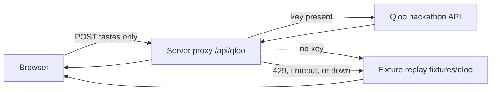

# TasteTrip 合味旅行

TasteTrip turns a taste conflict between two people into one reordered trip.

It does not average two profiles into a bland midpoint. It names the **conflicts**, finds the **intersection** both people can stand in, and **reorders** the route around that intersection.

Until a server holds a real Qloo key, the page runs on **fixed fake data**. Poster slots are flat color blocks labeled `placeholder`. This repository does not download or ship photographs.

## The conflict → intersection reorder

| | |
| --- | --- |
| Person A | 《布达佩斯大饭店》 (The Grand Budapest Hotel), jazz, hotpot (火锅) |
| Person B | Marvel, hip-hop, sushi |
| Conflicts | City vibe (城市气质), dining style (用餐方式) |
| Intersection | Urban nightlife (都会夜生活) |
| Reorder | Drop the split daytime plans. Walk one night instead. |

The night route, in order. Each stop is labeled with why both people would like it. Those lines are handwritten. They are the slot a Qloo affinity score would fill once a key exists:

1. **19:30 对称旅馆大堂** — Grand Budapest symmetry, but only after dark.
2. **20:10 双柜台夜食堂** — hotpot and sushi at one counter, not two restaurants.
3. **21:40 爵士转角 → 嘻哈地下室** — jazz first, hip-hop one block later.
4. **23:15 天台双银幕** — pastel hotel frames on one screen, a Marvel skyline on the other.

## What the page looks like

Warm paper, deep ink, one vermilion accent. No photographs.

The first screen is one sentence — 两个人的口味冲突 → 找出重叠 — and an ink **一键试玩** button. That button loads the fixed pair above.

- **Conflict** is two train-ticket stubs on the same paper. A is a solid ink line, B is a dashed ink line. Each stub carries three poster frames marked `placeholder` (film, music, food), a perforated edge, and an embossed serial number. The torn seam between the stubs is vermilion. With the recorded Qloo replay, that seam is three tensions: 城市气质, 音乐场, and 用餐方式. Each line carries a source tag.
- **Intersection** is those stubs pieced back into one route. Vermilion is the route line and the stop times. The tear and rejoin take about half a second. Every stop has the label: 为什么两人都喜欢 / Why both will like it, plus a source tag (`qloo:replay`, `qloo:entity`, or `mock:fixture`).
- If Qloo is rate-limited, the call times out, or the host is down, a small vermilion tag sits in a thin ink frame and the page still renders. The stops in that case are the recorded replay, tagged `qloo:replay`, not the handwritten itinerary.
- **预览断网回退** and **预览限流回退** force those two banners locally. They are labeled previews, not measured outages. The route under them is still the replay.
- **对照页** (`#compare`) runs the same taste pair twice. The left column is Qloo (live when a server key is set, otherwise the fixture replay). The right column is the no-graph rules baseline, tagged `mock:fixture`. There is no scoreboard and no claim that one side won.

Changing the six fields and pressing **用这组重排** asks the proxy again. **一键试玩** always returns to the original pair. With replay or a live key, that pair does not use the handwritten stops.

## Architecture

The browser never sees the key. It only posts taste strings to `/api/qloo`. The proxy reads `QLOO_API_KEY` from the server environment.



Locally the proxy is Vite middleware in `vite.config.js`. On Vercel it is `api/qloo.js`. On Netlify it is `netlify/functions/qloo.js` with a redirect in `netlify.toml`. GitHub Pages is a static host: `/api/qloo` 404s there, and the browser replays `fixtures/qloo` locally so the demo still renders with `qloo:replay` tags.

## Why the route changes when Qloo data is present

The hackathon asks for something that would not be the same product without the taste graph. On this page the check is visible.

- **一键试玩 with no server key** loads `fixtures/qloo/demo-pair.json`. Search entities and insights affinities build the conflicts and the stop order. Tags read `qloo:replay` or `qloo:entity`. They do not read `mock:fixture`.
- **The handwritten night route** in `src/data.js` (对称旅馆大堂, 双柜台夜食堂, 爵士转角 → 嘻哈地下室, 天台双银幕, overlap 都会夜生活) runs only as the right-hand column of `#compare`, tagged `mock:fixture`.
- **A live key** calls `GET /search` and `POST /v2/insights` on `https://hackathon.api.qloo.com`. Returned entities and `query.affinity` drive the same pipeline. Tags are `qloo:entity` only. A production page with a real key must not show `mock:fixture` or `qloo:replay`.
- **Scores are copied, not invented.** If a payload has no `query.affinity`, the page does not make one up.
- **The comparison is not a measurement.** The right column is the rules baseline actually running. It is not an LLM call, and the page does not say which side won.

The fixture affinities are illustrative sample payloads (see `fixtures/qloo/README.md`). They are not a captured live call.

## Run locally

Requires Node.js 20+.

```bash
npm install
npm run dev
```

Open the URL Vite prints, usually [http://127.0.0.1:5173](http://127.0.0.1:5173). Press **一键试玩**. Conflict and the reordered night route both show within a few seconds.

```bash
npm test
npm run build
npm run preview
```

## Server key

Copy `.env.example` to `.env.local` on your own machine. The proxy reads:

```bash
QLOO_API_KEY=
QLOO_BASE_URL=https://hackathon.api.qloo.com
QLOO_TIMEOUT_MS=8000
```

Leave `QLOO_API_KEY` empty to replay `fixtures/qloo`. The page then tags `qloo:replay`. Set the key in the server environment to call the live API; those responses are tagged `qloo:entity`, and the page must not show `mock:fixture` or `qloo:replay`. Never commit a real key. `.env` and `.env.local` are gitignored.

On Vercel or Netlify, set `QLOO_API_KEY` in the host's server environment. Do not put the key in the frontend build. The Pages workflow builds a static site and does not receive a key, so that host stays on fixture replay. A previously deployed Vercel project does not pick up proxy changes until that project is redeployed.

## Placeholders

Taste art is ink frames plus inline SVG ticket edges drawn in this repo. Each frame is labeled `placeholder`.

## Fonts

Three families, two weights, three sizes. All three are open source and free for commercial use under the SIL Open Font License 1.1.

| Role | Face | License |
| --- | --- | --- |
| Headings | [Noto Serif SC](https://fonts.google.com/noto/specimen/Noto+Serif+SC) (Source Han Serif / 思源宋体) | [OFL 1.1](https://scripts.sil.org/OFL) |
| Body | [Noto Sans SC](https://fonts.google.com/noto/specimen/Noto+Sans+SC) (Source Han Sans / 思源黑体) | [OFL 1.1](https://scripts.sil.org/OFL) |
| Numbers | [IBM Plex Mono](https://github.com/IBM/plex) | [OFL 1.1](https://github.com/IBM/plex/blob/master/LICENSE.txt) |

## Docs

- [docs/demo-script.md](docs/demo-script.md) — about two minutes, from the clash to the pieced route.
- [docs/milestones.md](docs/milestones.md) — weekly public versions through 30 Oct 2026.
- [docs/review.md](docs/review.md) — rules, risks, and fallback screenshots.

## License

MIT. See [LICENSE](LICENSE).
