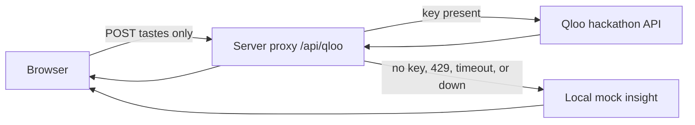

# TasteTrip 合味旅行

TasteTrip turns a taste conflict between two people into one reordered trip.

It does not average two profiles into a bland midpoint. It names the **conflicts**, finds the **intersection** both people can stand in, and **reorders** the route around that intersection.

Until a server holds a real Qloo key, the page runs on **fixed fake data**. Poster slots are flat color blocks labeled `placeholder`. This repository does not download or ship photographs.

## The conflict → intersection reorder

| | |
| --- | --- |
| Person A | 《布达佩斯大饭店》 (The Grand Budapest Hotel), jazz, hotpot (火锅) |
| Person B | Marvel, hip-hop, sushi |
| Conflicts | City vibe (城市气质), dining style (用餐方式) |
| Intersection | Urban nightlife (都会夜生活) |
| Reorder | Drop the split daytime plans. Walk one night instead. |

The night route, in order. Each stop is labeled with why both people would like it. Those lines are handwritten. They are the slot a Qloo affinity score would fill once a key exists:

1. **19:30 对称旅馆大堂** — Grand Budapest symmetry, but only after dark.
2. **20:10 双柜台夜食堂** — hotpot and sushi at one counter, not two restaurants.
3. **21:40 爵士转角 → 嘻哈地下室** — jazz first, hip-hop one block later.
4. **23:15 天台双银幕** — pastel hotel frames on one screen, a Marvel skyline on the other.

## What the page looks like

Black page, one typeface, flat color. No photographs.

The first screen is one sentence — 两个人的口味冲突 → 找出重叠 — and a yellow **一键试玩** button. That button loads the fixed pair above.

- **Conflict** is two train-ticket stubs. A is orange, B is blue. Each stub carries three poster-shaped color blocks marked `placeholder` (film, music, food). The torn seam between the stubs is the conflict: 城市气质 and 用餐方式.
- **Intersection** is those stubs pieced back into one acid-yellow itinerary, with a strip of A's orange and B's blue still on the edges. It opens with a short animation after the tear is visible. Every stop has a black label: 为什么两人都喜欢 / Why both will like it.
- If the proxy has no key, Qloo is rate-limited, the call times out, or the host is down, an orange **Fallback** banner stays on screen and the same tickets and route still render. The page does not go blank.
- **预览断网回退** and **预览限流回退** force those two banners locally. They are labeled previews, not measured outages.
- **对照页** (`#compare`) puts the same taste pair in two columns: the Qloo pipeline shape, and an LLM-only column. Both are placeholders. There are no scores and no claim that one side won.

Changing the six fields and pressing **用这组重排** asks the proxy again, then falls back locally when the proxy cannot answer. **一键试玩** always returns to the original pair.

## Architecture

The browser never sees the key. It only posts taste strings to `/api/qloo`. The proxy reads `QLOO_API_KEY` from the server environment.



Locally the proxy is Vite middleware in `vite.config.js`. On Vercel it is `api/qloo.js`. On Netlify it is `netlify/functions/qloo.js` with a redirect in `netlify.toml`. GitHub Pages is a static host: `/api/qloo` 404s there, and the page treats that as the offline fallback so the demo still renders.

## Why this does not work without Qloo

The hackathon asks for something that is different because it knows what people love. This demo does not have that yet.

- **Search never runs** without a server key. Entity ids are `mock:` plus the words you typed.
- **Insights never run.** The four stops for the demo pair are the canned night route in `src/data.js`, not places returned by Qloo.
- **Conflicts are string rules** in `src/pipeline/conflicts.js` (city vibe, dining style). They are not taste-graph tensions.
- **"Why both will like it" is handwritten.** A live response, when a key exists, still says affinity scores are not wired. The code does not invent a number.
- **The comparison page has no measurement.** The LLM column is placeholder copy. It is not a model output, and it is not a score against Qloo.

A key on the server is what turns step 02 from "回退" into entity names from `https://hackathon.api.qloo.com/search` and place suggestions from `POST /v2/insights`.

## Run locally

Requires Node.js 20+.

```bash
npm install
npm run dev
```

Open the URL Vite prints, usually [http://127.0.0.1:5173](http://127.0.0.1:5173). Press **一键试玩**. Conflict and the reordered night route both show within a few seconds.

```bash
npm test
npm run build
npm run preview
```

## Server key

Copy `.env.example` to `.env.local` on your own machine. The proxy reads:

```bash
QLOO_API_KEY=
QLOO_BASE_URL=https://hackathon.api.qloo.com
QLOO_TIMEOUT_MS=8000
```

Leave `QLOO_API_KEY` empty to stay on the local fallback. Never commit a real key. `.env` and `.env.local` are gitignored.

On Vercel or Netlify, set `QLOO_API_KEY` in the host's server environment. Do not put the key in the frontend build. The Pages workflow builds a static site and does not receive a key.

## Placeholders

Taste art is CSS color blocks plus inline SVG ticket edges drawn in this repo. Each block is labeled `placeholder`.

## Docs

- [docs/demo-script.md](docs/demo-script.md) — about two minutes, from the clash to the pieced route.
- [docs/milestones.md](docs/milestones.md) — weekly public versions through 30 Oct 2026.
- [docs/review.md](docs/review.md) — rules, risks, and fallback screenshots.

## License

MIT. See [LICENSE](LICENSE).
