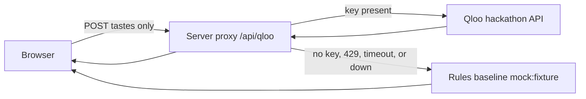

# TasteTrip 合味旅行

TasteTrip turns a taste conflict between two people into one reordered trip.

It does not average two profiles into a bland midpoint. It names the **conflicts**, finds the **intersection** both people can stand in, and **reorders** the route around that intersection.

Until a server holds a real Qloo key, the page runs on a rules baseline. This repository does not download or ship photographs, and it does not store Qloo responses.

## The conflict → intersection reorder

| | |
| --- | --- |
| Person A | Whiplash, niche jazz (小众爵士 Kamasi Washington), Blue Note |
| Person B | 深夜食堂, 深夜食堂, late-night food (夜宵) |
| Conflicts | City vibe (城市气质), dining style (用餐方式) |
| Intersection | Urban nightlife (都会夜生活) |
| Reorder | Drop the split daytime plans. Walk one night instead. |

The night route, in order. Each stop is labeled with why both people would like it. Those lines are handwritten. They are the slot a Qloo affinity score would fill once a key exists:

1. **19:30 对称旅馆大堂** — Grand Budapest symmetry, but only after dark.
2. **20:10 双柜台夜食堂** — hotpot and sushi at one counter, not two restaurants.
3. **21:40 爵士转角 → 嘻哈地下室** — jazz first, hip-hop one block later.
4. **23:15 天台双银幕** — pastel hotel frames on one screen, a Marvel skyline on the other.

## What the page looks like

Warm paper, deep ink, one vermilion accent. No photographs.

The first screen is one sentence — 两个人的口味冲突 → 找出重叠 — and an ink **一键试玩** button. That button loads the fixed pair above.

- **Conflict** is two train-ticket stubs on the same paper. A is a solid ink line, B is a dashed ink line. Each stub lists work, music, and food in type, with a perforated edge and an embossed serial number. The torn seam between the stubs is vermilion. Each conflict line carries a source tag.
- **Intersection** is those stubs pieced back into one route. Vermilion is the route line and the stop times. The tear and rejoin take about half a second. Every stop has the label: 为什么两人都喜欢 / Why both will like it, plus a source tag. Live Qloo uses `qloo:entity`. The no-key rules baseline uses `mock:fixture`.
- If the server has no key, Qloo is rate-limited, the call times out, or the host is down, a small vermilion tag sits in a thin ink frame and the page still renders. Those stops are the rules baseline, tagged `mock:fixture`.
- **预览断网回退** and **预览限流回退** force those two banners locally. They are labeled previews, not measured outages.
- **对照页** (`#compare`) runs the same taste pair in two columns. The left column is filled only when the server returns a live Qloo response. The right column is the no-graph rules baseline, tagged `mock:fixture`. There is no scoreboard and no claim that one side won.

Changing the six fields and pressing **用这组重排** asks the proxy again. **一键试玩** always returns to the original pair.

## Architecture

The browser never sees the key. It only posts taste strings to `/api/qloo`. The proxy reads `QLOO_API_KEY` from the server environment.



Locally the proxy is Vite middleware in `vite.config.js`. On Vercel it is `api/qloo.js`. On Netlify it is `netlify/functions/qloo.js` with a redirect in `netlify.toml`. GitHub Pages is a static host: `/api/qloo` 404s there, and the page shows the rules baseline so it does not go blank.

## Why the route changes when Qloo answers

The hackathon asks for something that would not be the same product without the taste graph.

- **No server key**, or a failed live call, does not pretend to be Qloo. **一键试玩** shows the rules baseline in `src/data.js` (都会夜生活, 爵士窄门, 夜宵窗口, 只留一首, 热食收口), tagged `mock:fixture`, and the page says 这次是备用数据. That path is the explicit fallback, including the right column of `#compare`. A cached live hit says Qloo 实时结果（已缓存）.
- **A server key** calls only `https://hackathon.api.qloo.com`. Search is `GET /search` with a `types` parameter (`urn:entity:movie`, `urn:entity:tv_show`, `urn:entity:brand`, `urn:entity:artist`, `urn:entity:place`). Insights is `GET /v2/insights` with query parameters: `filter.type=urn:entity:place` and `signal.interests.entities` for the route, plus `filter.results.entities` to read cross-affinity. The header is `X-Api-Key`. The client does not POST a JSON body, does not call `/recs`, and does not use `urn:entity:food_and_drink`. Staging and production hosts are not called. Returned entity names and `query.affinity` drive conflicts and stop order, tagged `qloo:entity`.
- **Scores are copied, not invented.** If a payload has no `query.affinity`, the page does not make one up.
- **The comparison is not a measurement.** The right column is the rules baseline actually running. It is not an LLM call, and the page does not say which side won.

Handwritten sample payloads are not used as a stand-in for a live graph. Qloo’s terms also say not to commit API responses in a public repo. This workspace has no server key, so live search and insights were not called here. Set `QLOO_API_KEY` on the server and redeploy for the public page to show `qloo:entity`.

## Run locally

Requires Node.js 20+.

```bash
npm install
npm run dev
```

Open the URL Vite prints, usually [http://127.0.0.1:5173](http://127.0.0.1:5173). Press **一键试玩**. Conflict and the reordered night route both show within a few seconds.

```bash
npm test
npm run build
npm run preview
```

## Server key

Copy `.env.example` to `.env.local` on your own machine. The proxy reads:

```bash
QLOO_API_KEY=
QLOO_TIMEOUT_MS=8000
```

The host is fixed to `https://hackathon.api.qloo.com`. A staging or production base URL is not used.

Leave `QLOO_API_KEY` empty to stay on the rules baseline, tagged `mock:fixture`. Set it in the server environment to call the live API; those responses are tagged `qloo:entity`. A plain key is sent as-is. Vercel may store `QLOO_API_KEY` as the XOR-0x5A hex of the real key; an even-length hex value of 64 characters or more is decoded that way before the request. The proxy always uses `https://hackathon.api.qloo.com` and ignores any other host. Never commit a real key. `.env` and `.env.local` are gitignored.

On Vercel or Netlify, set `QLOO_API_KEY` in the host's server environment, then redeploy. Do not put the key in the frontend build. A previously deployed Vercel project does not pick up this proxy until that project is redeployed with the variable set. The Pages workflow builds a static site and does not receive a key, so that host stays on `mock:fixture`.

## Placeholders

Ticket edges are inline SVG drawn in this repo. Taste lines are type, not pictures.

## Fonts

Three families, two weights, three sizes. All three are open source and free for commercial use under the SIL Open Font License 1.1.

| Role | Face | License |
| --- | --- | --- |
| Headings | [Noto Serif SC](https://fonts.google.com/noto/specimen/Noto+Serif+SC) (Source Han Serif / 思源宋体) | [OFL 1.1](https://scripts.sil.org/OFL) |
| Body | [Noto Sans SC](https://fonts.google.com/noto/specimen/Noto+Sans+SC) (Source Han Sans / 思源黑体) | [OFL 1.1](https://scripts.sil.org/OFL) |
| Numbers | [IBM Plex Mono](https://github.com/IBM/plex) | [OFL 1.1](https://github.com/IBM/plex/blob/master/LICENSE.txt) |

## Docs

- [docs/demo-script.md](docs/demo-script.md) — about two minutes, from the clash to the pieced route.
- [docs/milestones.md](docs/milestones.md) — weekly public versions through 30 Oct 2026.
- [docs/review.md](docs/review.md) — rules, risks, and fallback screenshots.

## License

MIT. See [LICENSE](LICENSE).
