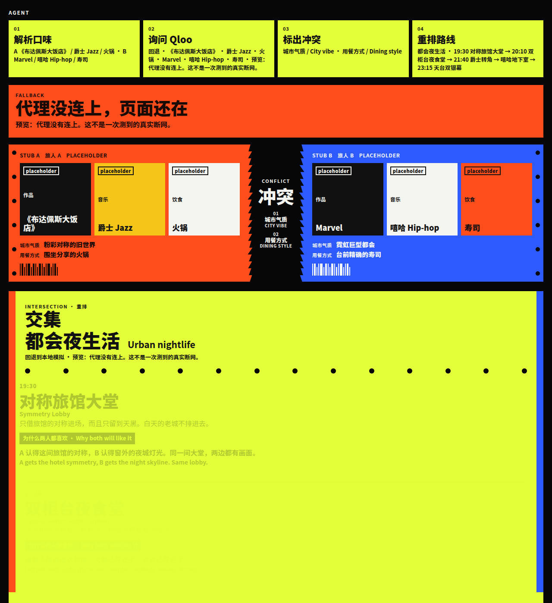
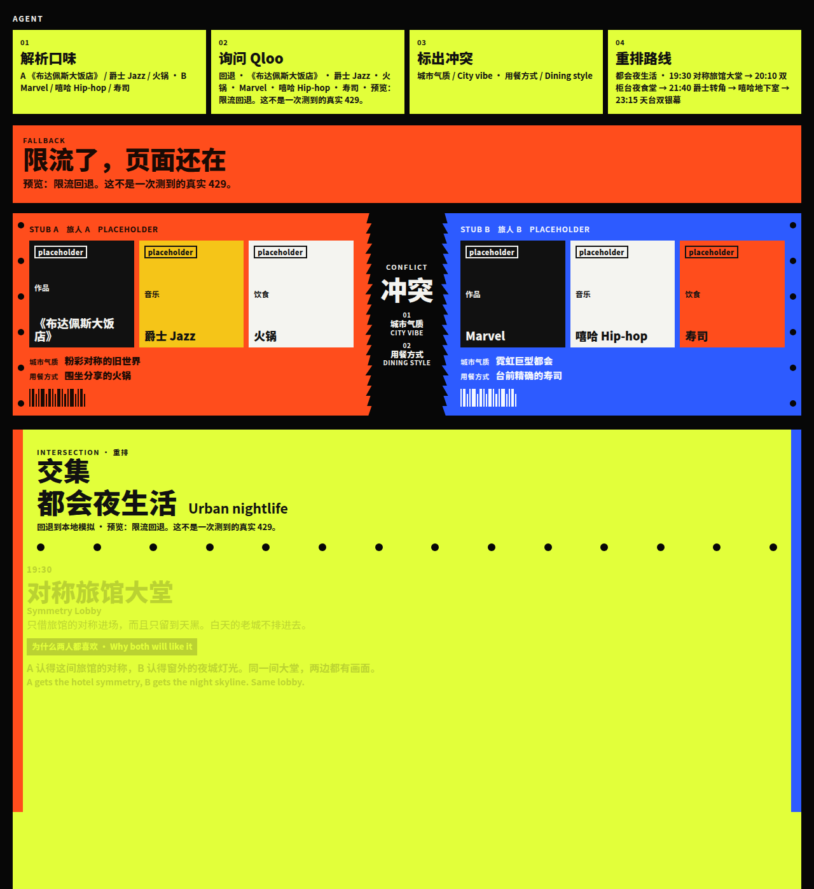

# TasteTrip review pack

Rules below are taken from the hackathon page on 10 Oct 2026: [Qloo Agentic Hackathon on Devpost](https://qloo.devpost.com/). This file does not add rules that page does not state.

## What the page requires

Deadline: **30 Oct 2026, 11:45pm EDT**.

A submission has to include all of these:

1. A link to a functional demo people can try end to end.
2. A public git repository with the source, assets, and run instructions.
3. A text description of what it does and why it is Qloo-powered.
4. External hosting. A demo that only runs locally, or that needs private access, does not qualify.
5. An open-source license, with the file visible in the repo About section.

Demo videos are not required. The page says judges need something they can actually use.

The build brief says the project should integrate the Qloo API, and that cultural intelligence is the difference. The same page says: if the submission would work the same without Qloo, it is the wrong thing.

Judging criteria named on that page: Technological Implementation, Design, Potential Impact, Quality of the Idea.

API key guide linked from the page: [Getting your API key](https://docs.qloo.com/reference/qloo-llm-hackathon-developer-guide#getting-your-api-key). Kit: [qloo/qloo-hackathon-kit](https://github.com/qloo/qloo-hackathon-kit).

## Public preview

These URLs were answering HTTP 200 on 10 Oct 2026 from the dev server behind a Cloudflare quick tunnel. The tunnel dies when that process stops. It is not a host that lasts until 30 Oct.

- [TasteTrip](https://beef-broader-table-sci.trycloudflare.com/)
- [Offline fallback preview](https://beef-broader-table-sci.trycloudflare.com/?preview=offline)
- [Rate-limit fallback preview](https://beef-broader-table-sci.trycloudflare.com/?preview=rate_limit)
- [Comparison page](https://beef-broader-table-sci.trycloudflare.com/#compare)

Repo: [xinyurun215/tastetrip-agent](https://github.com/xinyurun215/tastetrip-agent). Work stays on the PR branch. Nothing in this pack is published by pushing `main`.

## Fallback screenshots

Both shots are the page after the pipeline finishes. The orange bar is the fallback. The tickets and the yellow night route are still on the page.

The offline and rate-limit buttons are labeled previews. They do not measure a real network failure or a real HTTP 429. Copy on the bar says that.

### Offline

`/?preview=offline` skips the proxy and still draws the torn stubs and the four stops.

### Rate limited

`/?preview=rate_limit` does the same with the rate-limit bar.

Pressing **一键试玩** with no server key is a third fallback: the bar says there is no key, and the same route still renders. A missing proxy (static GitHub Pages, where `/api/qloo` 404s) is handled the same way as a dead proxy: the page shows local data instead of going blank.

## Comparison page

`#compare` shows the same taste pair in two columns. Both are placeholders. There is no score and no claim that one side won. The right column is handwritten filler, not a model response.

## How the built frontend was checked for a key

The browser only posts taste strings to `/api/qloo`. The server variable is read in `server/handleQloo.js`, which is imported by the Vite middleware, `api/qloo.js`, and `netlify/functions/qloo.js`. Frontend source under `src/` is not allowed to contain that variable name or the old browser env name. `test/noBrowserKey.test.js` walks `src/` and `index.html`.

CI then runs `npm run build` and searches `dist/` for those names. The workflow fails if either string is in the built files. A local build on 10 Oct 2026 was searched the same way and was clean. A repo-wide search for the old browser env name was also clean.

GitHub Pages builds the static site and does not receive a key. Vercel and Netlify read the key from the host's server environment, not from the frontend bundle.

## Known risks

- **This is not Qloo-powered yet.** With no server key, search and insights never run. Conflicts are string rules. The night route and the "why both" lines are handwritten. The Devpost brief says a project that works the same without Qloo is the wrong thing. That describes the current demo.
- **A live response still would not show affinity scores.** The proxy is written so a successful call returns entities and place suggestions, and it says scores are not wired. It does not invent a number.
- **The comparison is not a measurement.** Do not read it as evidence that Qloo beat a language model.
- **The public URL is a quick tunnel.** It is not the 30 Oct archive.
- **GitHub Pages is not enabled.** `POST /repos/xinyurun215/tastetrip-agent/pages` returns 403 `Resource not accessible by integration`. A repo admin has to set Settings → Pages → Build and deployment → Source to **GitHub Actions**. This token cannot do that. The Pages workflow will fail at deploy until then. Static Pages also cannot run the proxy, so that host would stay on the fallback.
- **Vercel and Netlify need a login this run does not have.** No host token is configured. The config files are in the repo so a person who can log in can set the server variable and deploy.
- **The About-section license checkbox** is a GitHub setting. `LICENSE` is in the repo. This run cannot confirm the About section shows it.
- **The tunnel and the dev server are one machine.** If they stop, the links above 404.

## Not done yet

- A real key in the server environment, and a public host that actually runs `/api/qloo`.
- Replacing handwritten "why both" lines with Qloo affinity.
- A measured side-by-side against a language model. The page is only the layout.
- A durable URL that still works on 30 Oct 2026, 23:45 ET.
- Turning on GitHub Pages, which is blocked on the admin step above.
